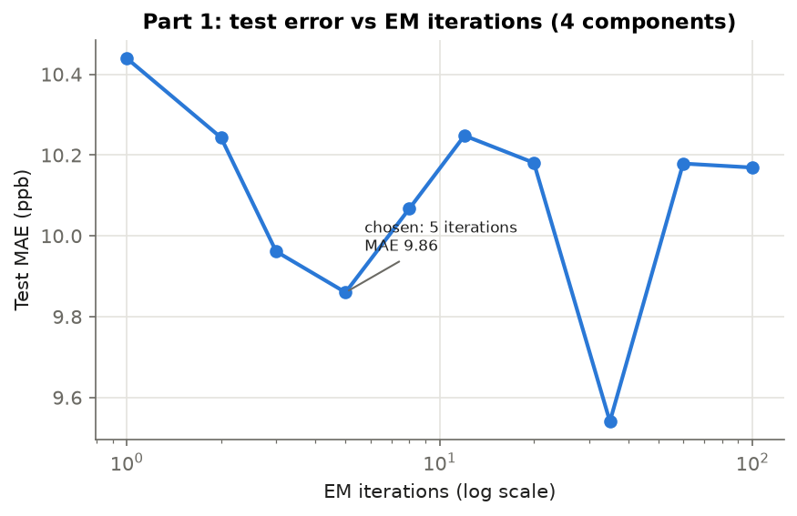
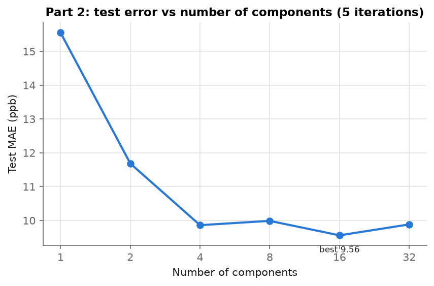
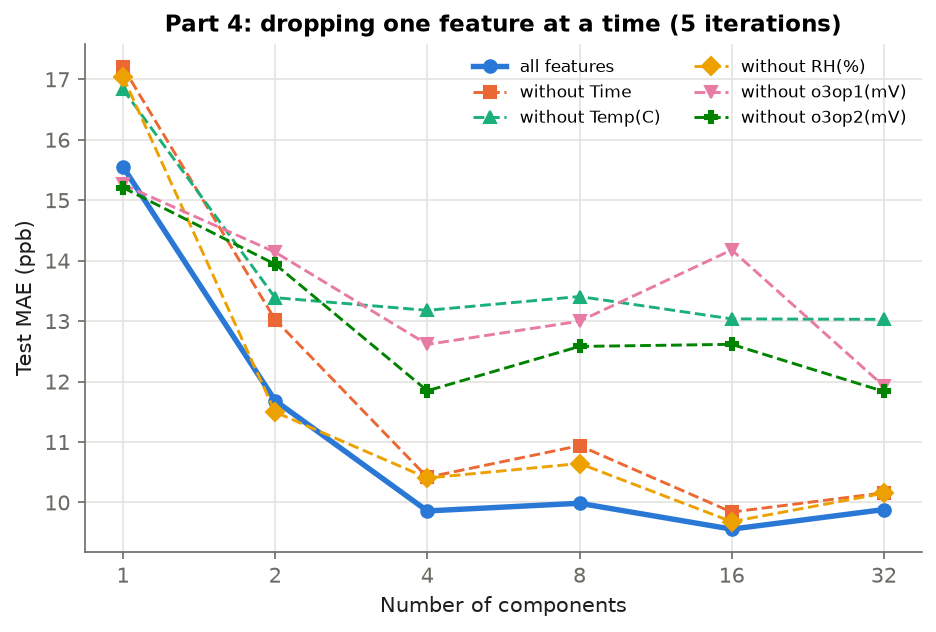
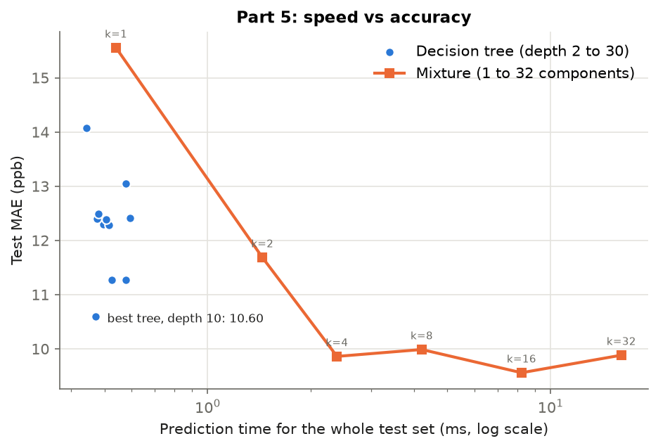
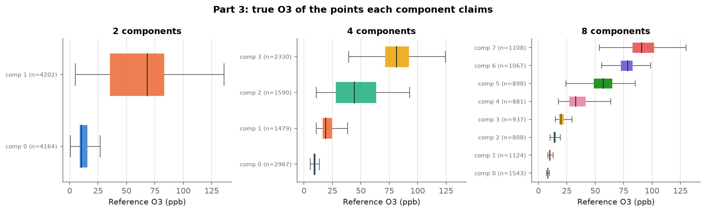

# Latent Regime Prediction: mixed linear regression for O3 sensor calibration

Course project for **CS771 (Introduction to Machine Learning)** at IIT Kanpur,
under Prof. Purushottam Kar (Assignment 3, Jan–Apr 2026).

Low-cost air-quality sensors give voltages, not ozone levels. The task is to
predict the **reference O3 reading (ppb)** from the sensor's two O3 voltages,
temperature, humidity and hour of day. One straight-line model does poorly,
because the sensor behaves differently in different conditions ("regimes").
We fit **several linear models at once** and learn which one to use for each
reading: a **mixture of experts**, where the linear "experts" are fitted with
Expectation–Maximization (EM) and a "router" picks one expert per reading.

## Method in plain words
1. **Start:** sort the training points by O3 into K equal-sized groups and fit
   one ridge regression per group.
2. **Assign (E-step):** give each training point to the model that predicts it
   best (smallest error).
3. **Refit (M-step):** refit each model on only its own points.
   Repeat steps 2–3 a few times.
4. **Route:** at test time the true O3 is unknown, so a linear classifier
   (LinearSVC) learns, from the features alone, which model each point belongs to.
5. **Compare** with a tuned decision tree, on both error and prediction time.

Code: `lrp/model.py` (the model), `lrp/experiments.py` (the five parts),
`lrp/plots.py` (figures), `run_all.py` (runs everything).

## Results
Data: `data/DD1(Oct).csv`, 10,458 valid readings. The first 80% (8,366) are for
training and the last 20% (2,092) for testing, in time order. Error is the mean
absolute error (MAE) on the test set, in ppb.

| Model | Test MAE (ppb) |
|---|---|
| One linear model (K = 1) | 15.55 |
| Mixture, K = 2 | 11.68 |
| **Mixture, K = 4, 5 iterations** (chosen) | **9.86** |
| Mixture, K = 16 | 9.56 |
| Best decision tree (depth 10, tuned) | 10.60 |

- Four regimes cut the error by **37%** compared with one linear model, and
  give **7% lower error** than the best decision tree.
- **Why K = 4:** K = 16 is slightly better (9.56), but needs four times as many
  experts. K = 4 is close to the best, and four regimes are easy to read (Part 3).
- **Part 1:** the first 3–5 EM iterations give the big drop, after which the
  error levels off. 5 iterations are used.
- **Part 3:** the components split the data by ozone level, from a "clean air"
  regime near 10 ppb up to a high-ozone regime near 80–100 ppb.
- **Part 4:** temperature and the two O3 voltages matter most: dropping one of
  them raises the K = 4 error by 2.0–3.3 ppb. Dropping hour of day or humidity
  raises it by about 0.5 ppb.
- **Part 5:** the tree is faster (well under 1 ms for the whole test set); the
  mixture is more accurate. The K = 4 mixture takes about 4× as long as the best
  tree (median of 50 timing runs; the exact ratio depends on the machine).

| | |
|---|---|
|  |  |
|  |  |



**Note on tuning:** following the assignment setup, the number of iterations,
components and tree settings were chosen on the 80/20 time split. The tree
settings follow the final notebook (`min_samples_split=2`).

## How to run
```bash
pip install -r requirements.txt
python run_all.py        # ~20 s: writes results/*.csv, results/summary.json, figures/*.png
python check_results.py  # checks the key numbers against the submitted report
```
`scikit-learn==1.7.2` is pinned so the decision-tree baseline reproduces
exactly; newer versions change the tree's split criterion slightly.

## Repository
```
lrp/            data.py  model.py  experiments.py  plots.py
run_all.py      check_results.py   requirements.txt
data/           DD1(Oct).csv (sensor deployment data)
results/        CSV tables and summary.json
figures/        five figures
notebooks/      final_submission.ipynb (the notebook used for the report; it
                expects DD1(Oct).csv in its own folder)
report/         submitted_report.pdf
```

## Team
Aamir Ahmad, Anisha Nanda, Aaryan Maheshwari, Pallav Rastogi, Sahil Pandey,
Tattwa Shiwani.

## Data
Sensor data from the course, originally from the SATVAM low-cost sensor project
(see https://github.com/purushottamkar/aqi-satvam).
